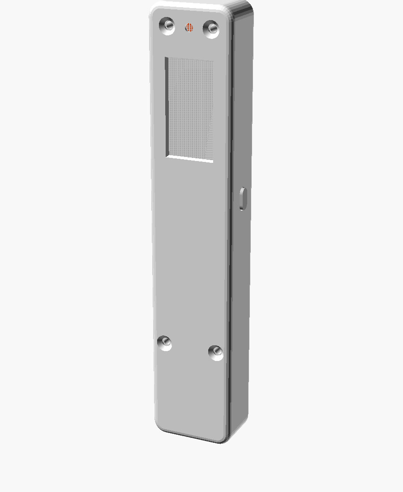

# Pocket voice recorder

A one-button voice recorder with an e-ink window. Press, talk, press again. It saves to microSD, sends the recording to your Mac over Wi-Fi, and the Mac transcribes it locally with Whisper, free and private. The first words of each transcript become the note's title in **Files** on the recorder.

| MVP concept | This design (CAD preview) |
| --- | --- |
|  |  |

*The concept is the target. The right-hand image is an OpenSCAD preview, not a photo of a built recorder.*

- **Electronics:** Seeed XIAO ESP32-S3 Sense (mic, microSD, battery charging), a 0.97" Good Display e-ink panel, one side button, an orange status LED.
- **Case:** one parametric OpenSCAD file: back, front lid with the window, button, optional clip. About 110 x 21 x 14 mm; the concept's 18 x 8 mm needs a custom PCB, and [the design doc](docs/DESIGN.md#the-concept-and-what-changes-to-build-it-now) lists every place the MVP differs from the concept and why.
- **Transcription:** `mac/receiver.py` with whisper.cpp on your Mac.

## Status

Designed, not built. The firmware compiles, the screens are rendered from the real drawing code, and the case renders and fit-checks in CI, but nothing has run on hardware or been printed. The checklist is in [docs/DESIGN.md](docs/DESIGN.md#validation-plan).

## Build one

1. Buy the parts and wire them: [docs/DESIGN.md](docs/DESIGN.md#parts).
2. Measure your parts, then print the case: [docs/DESIGN.md](docs/DESIGN.md#print-and-assemble).
3. Flash the firmware: [docs/DESIGN.md](docs/DESIGN.md#flash).
4. Start the receiver on your Mac: [docs/RECEIVER.md](docs/RECEIVER.md).

## Layout

| Path | What |
| --- | --- |
| `firmware/` | PlatformIO firmware |
| `cad/` | `recorder.scad`, ready-made STLs, preview renders |
| `tools/screen-preview/` | Renders every e-ink screen to PNG on a desktop |
| `mac/receiver.py` | Mac receiver and transcriber |
| `docs/DESIGN.md` | Brief, concept vs MVP, design decisions, parts, wiring, assembly, validation plan |
| `docs/RECEIVER.md` | Receiver setup and the wire protocol |
| `docs/reference/` | The MVP concept image and the rendered screens |

This is the `voice-pen` branch of [coobytron/M5-Stick-Plus-1.1---Voice](https://github.com/coobytron/M5-Stick-Plus-1.1---Voice): a separate history with nothing from the M5StickC firmware, so it can move to a repository of its own with one push. Work on the recorder branches from `voice-pen` and merges back into it, not into `main`. (The branch name is from the first version, a pen-shaped design, which this MVP replaces.)
