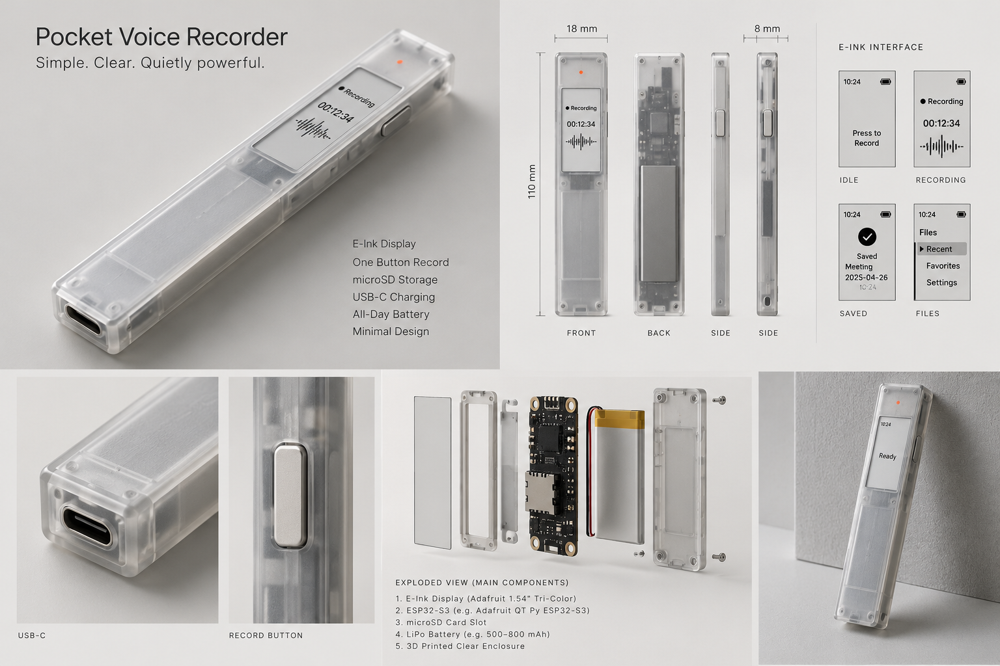
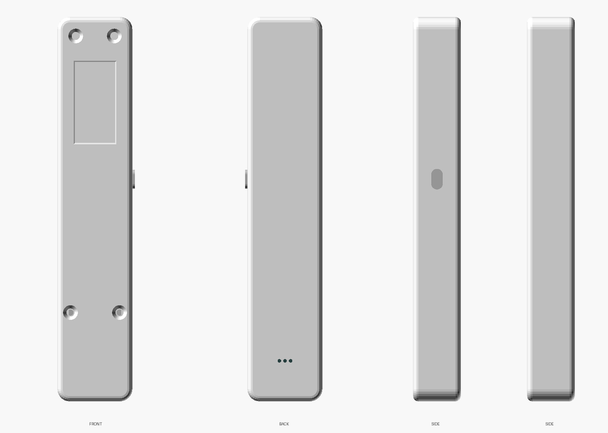
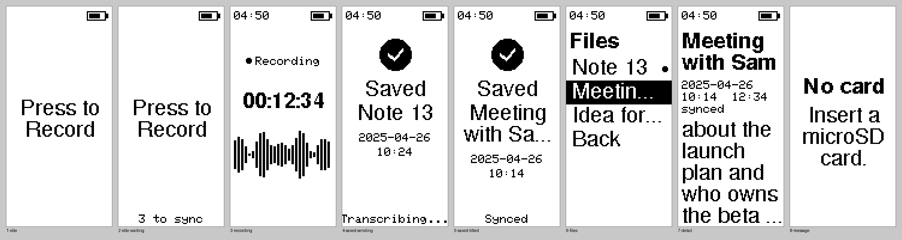

# Pocket voice recorder: design

A one-button voice recorder with an e-ink window. Press the side button, talk, press again. It saves the recording to microSD, sends it to your Mac over Wi-Fi, and the Mac transcribes it locally with Whisper, free and private. The first words of each transcript become the note's title in **Files** on the recorder.

| MVP concept (the target) | This design (CAD preview) |
| --- | --- |
|  |  |

*Left: the concept image Colson supplied as the MVP, kept unchanged in `docs/reference/concept-mvp.png`. Right: OpenSCAD previews of `cad/recorder.scad`, not a photo or a print. Neither is a finished look; the printed part is the next review.*

Status: **designed, not built.** The firmware compiles, every screen is rendered on a desktop from the real drawing code, and the case parts render and fit-check in CAD. Nothing has run on hardware or been printed. See [Validation plan](#validation-plan).

## Brief

Following the Agent Cody Banks project brief template.

- **Goal:** the recorder in the MVP concept: one button, e-ink screen, microSD storage, USB-C charging, minimal design, plus transcription.
- **Audience:** Colson, capturing ideas and meetings on the go.
- **Constraints:** ESP32 family; parts you can buy online and hand-wire; printable on a hobby printer; transcription free and local, using the Mac receiver shared with the [M5StickC dictation recorder](https://github.com/coobytron/M5-Stick-Plus-1.1---Voice) ([RECEIVER.md](RECEIVER.md)).
- **Non-goals (MVP):** on-device transcription (an ESP32 can't run Whisper), playback, a phone app, a custom PCB, the concept's "Favorites" and "Settings" menus.

### Acceptance criteria

- [x] Firmware compiles for the recorder and for a bench display (CI).
- [x] Every screen in the concept that the MVP keeps (idle, recording, saved, files) is drawn and fits the 88 x 184 panel (desktop preview, CI).
- [x] Every case part renders from one parametric file, and no printed part overlaps another or the bought parts' outlines (CAD check, below).
- [ ] One press from sleep starts recording within about a second, without losing the first word.
- [ ] Holding the button opens Files; press moves, hold opens a note.
- [ ] A recording made with no Wi-Fi uploads by itself later, keeps the time it was spoken, and gets its transcript title.
- [ ] Everything fits in the printed case, the lid closes flush, and the button clicks.

## The concept, and what changes to build it now

The concept is the target for look and behaviour. Some of what it shows can't be built with the parts it lists. Where that happens, this design keeps the look and changes the number, and says so:

| Concept | This MVP | Why |
| --- | --- | --- |
| 110 x 18 x 8 mm | **109.8 x 21.4 x 13.6 mm** | The smallest ESP32-S3 boards with USB-C are 17.8 mm wide (XIAO and QT Py alike), so 18 mm outside leaves no wall. The XIAO board stacked on its Sense mic/microSD board sets the thickness. Reaching 18 x 8 needs a custom PCB (see [Later](#later)). |
| Adafruit 1.54" tri-colour e-ink | **Good Display 0.97" black and white (GDEM0097T61)** | Adafruit's 1.54" board is 43 x 43 mm and can't fit an 18 or 21 mm body. The narrow portrait screen drawn in the concept matches the 0.97" panel (active area 10.65 x 22.26 mm). Tri-colour panels also take many seconds per refresh, which rules out a running timer. |
| Adafruit QT Py ESP32-S3 + separate microSD | **Seeed XIAO ESP32-S3 Sense** | Same footprint, and its Sense board adds the microphone and microSD slot, so there's less to wire. |
| 500-800 mAh LiPo | **6 x 15 x 35 mm LiPo (size code 601535)** | What fits beside the board and screen. By volume that's about a third of a common 500 mAh cell (5 x 34 x 50 mm), so expect a few hundred mAh; check the seller's figure. Battery life isn't measured yet. |
| Button beside the screen | **Button just below the screen** | The screen and its adapter board fill the width beside it. |
| Clock on the idle screen | **Clock on active screens only** | An e-ink clock freezes while the recorder sleeps, which would show the wrong time. |
| Files: Recent, Favorites, Settings | **Files: the recent notes** | One button can't comfortably drive three menus. Favorites and Settings are in [Later](#later). |
| Clear enclosure | **Clear or frosted print** | Print in clear PETG for the frosted look, or order clear resin (SLA) for something closer to the render. |
| No clip | **Optional clip** | The first brief asked for one; it's a separate part that screws on (`with_clip = true`). |

## How it works

```text
 press            press again           Wi-Fi (when in reach)                    e-ink
┌──────────┐ PCM ┌───────────────┐    ┌──────────────────────────┐  "TEXT ..." ┌──────────────┐
│ PDM mic  ├────►│ WAV on micro- ├───►│ Mac: mac/receiver.py     ├────────────►│ Saved: title │
│ 16 kHz   │     │ SD /rec/      │    │ whisper.cpp, ~/Dictation │             │ Files list   │
└──────────┘     └───────────────┘    └──────────────────────────┘             └──────────────┘
```

1. **Asleep.** Deep sleep; the e-ink keeps showing "Press to Record", the battery level and how many notes wait to sync, using no power.
2. **Press.** The button wakes the chip. The mic starts first, before the card and screen, so the ~1 s of boot audio is buffered (64 KB, about 2 s) rather than lost. The orange LED lights; the screen shows "● Recording", an hh:mm:ss timer and a waveform of the last 7 seconds, refreshed once a second.
3. **Press again.** The WAV is closed on the card as `/rec/<n>_<unix time>.wav` and listed in `/notes.txt`. Under half a second counts as a mis-press and is deleted. The screen shows the "Saved" check.
4. **Sync.** The recorder joins Wi-Fi, finds the Mac over Bonjour and uploads every waiting recording, oldest first, deleting each once the Mac confirms. For each one it waits up to 90 s for the transcript, whose first words become the note's title. The "Saved" screen shows the progress, then the new title.
5. **Sleep.** If anything is still waiting (no Wi-Fi, Mac off), it wakes every 30 minutes to retry.

### Controls

One button, on the right edge.

| When | Press | Hold (0.7 s) |
| --- | --- | --- |
| Asleep | Start recording | Open Files |
| Recording | Stop and save | — |
| Files list | Next note (the last row is "Back") | Open the selected note, or leave on "Back" |
| A note | Back to the list | Back to the list |

Files closes itself after 20 s untouched.

### Screens

Rendered on a desktop from `firmware/src/screen.cpp` by `tools/screen-preview/` (sample data; the clock shows the time the preview ran):



The fonts are ASCII-only, so the receiver sends transcripts folded to plain ASCII (curly quotes become straight, accents are dropped). The full transcript on the Mac is untouched.

## Parts

Prices vary; check current listings.

| Part | Notes |
| --- | --- |
| Seeed Studio XIAO ESP32-S3 **Sense** | Board plus its Sense expansion board (mic + microSD). Camera unplugged. Keep the Wi-Fi antenna it ships with. |
| Good Display GDEM0097T61 0.97" e-ink | 88 x 184, SSD1680, 18-pin FPC. |
| Good Display DESPI-C02-CV0097 adapter | The panel's boost circuit. Its size isn't published: measure it. |
| LiPo pouch, about 6 x 15 x 35 mm (601535) | With protection circuit. |
| 6 x 6 mm tactile switch, 5 mm tall | Mounted on its side behind the edge button. |
| 3 mm orange LED + 330 Ω resistor | |
| 2 x 220 kΩ resistors | Battery-voltage divider. |
| 4 x M2 x 5 flat-head screws | Self-tapping into the printed posts. Longer ones can reach the battery behind the lower posts. |
| microSD card, up to 32 GB, FAT32 | |
| Thin silicone wire (30 AWG) | |
| Filament | Clear PETG for the case; silver PLA for the button if you want the concept's metal look. |

## Wiring

| From | To XIAO pin | GPIO |
| --- | --- | --- |
| E-ink adapter CS | D0 | 1 |
| E-ink adapter D/C | D1 | 2 |
| E-ink adapter RES | D2 | 3 |
| E-ink adapter BUSY | D3 | 4 |
| E-ink adapter SCK | D8 | 7 |
| E-ink adapter SDI | D10 | 9 |
| E-ink adapter 3.3V / GND | 3V3 / GND | |
| Button, one leg | D4 | 5 |
| Button, other leg | GND | |
| LED anode via 330 Ω, cathode to GND | D6 | 43 |
| Battery + via 220 kΩ, and 220 kΩ to GND (midpoint to pin) | D5 | 6 |
| Battery + / − | BAT+ / BAT− pads on the back of the XIAO | |

The e-ink shares the SPI bus with the Sense board's microSD card (CS on GPIO 21). GPIO 21 is also the XIAO's own LED, so that one flickers while the card is busy; the orange LED on D6 is the one you see through the case. GPIO 43 is free because this board's serial port runs over USB.

## Print and assemble

The case is one parametric file, [`cad/recorder.scad`](../cad/recorder.scad): a **back** that holds everything, a **front** lid with the window, a **button**, and an optional **clip**. Ready-made STLs for the default sizes are in [`cad/stl/`](../cad/stl), already in print orientation.

1. **Measure first.** Check every value marked `MEASURE` in `recorder.scad` against your parts: the XIAO stack height, where its USB-C port and mic sit, the e-ink adapter, your battery. Then re-export:
   ```sh
   cd cad
   for p in back front button; do openscad -D "part=\"$p\"" -o stl/$p.stl recorder.scad; done
   ```
   OpenSCAD stops with a message if something no longer fits.
2. **Print.**

   | Part | Orientation | Notes |
   | --- | --- | --- |
   | `back` | back face down | The two lower screw posts overhang about 3 mm on their inner side; most printers manage, otherwise add supports there. |
   | `front` | outer face down | The screen window is open; the panel's glass is the surface. |
   | `button` | flange down | |
   | `clip-optional` | outer face down | PETG. Print `back-for-clip` instead of `back`; it has holes for the clip's screws. |

   `clear`, `fit` and `wall` at the top of the file tune fits for your printer.
3. **Assemble.**
   1. Seat the XIAO at the USB-C end with its port in the opening.
   2. Stick the battery to the back's floor between its two ribs.
   3. Put the button in from inside, flange first against the wall, then push the switch into the cradle behind it.
   4. Tape the panel into the front's shallow pocket so its active area fills the window, with the adapter taped behind it. Push the LED into its seat above the window.
   5. Close the front and fit the four screws.

### CAD fit check

With the default sizes, OpenSCAD intersections were run between each pair of printed parts and between the parts and box outlines of the bought parts (board stack, battery, panel + adapter, switch, LED). None overlap; the only shared surfaces are where they're meant to touch (board against the end wall, battery against its ribs, switch against its cradle). This checks the model, not the real parts: the outlines are boxes from listings.

## Flash

You need [PlatformIO](https://platformio.org/install).

1. Copy `firmware/src/secrets.example.h` to `firmware/src/secrets.h`. Add your Wi-Fi and your time zone.
2. Hold the XIAO's **B** (boot) button while plugging it in (the recorder deep-sleeps, which turns USB off), then:
   ```sh
   cd firmware
   pio run -t upload
   ```
3. Start the receiver on your Mac as described in [RECEIVER.md](RECEIVER.md).

To try the firmware before the 0.97" panel arrives, wire a common 2.13" SSD1680 module (GDEY0213B74, or a WeAct 2.13" board) the same way and flash `pio run -e bench213 -t upload`.

## Code map

| Path | Responsibility |
| --- | --- |
| `firmware/src/main.cpp` | Wake, record to microSD, sync, Files navigation, sleep |
| `firmware/src/screen.{h,cpp}` | Every e-ink screen |
| `firmware/src/notes.{h,cpp}` | The notes list on the card (`/notes.txt`) |
| `firmware/src/config.h` | Pins and tunables |
| `firmware/lib/GxEPD2_097_T61/` | 0.97" panel driver: GxEPD2's SSD1680 2.13" driver with the panel size changed (GxEPD2 has no 0.97" class). GPL-3.0, like GxEPD2. |
| `tools/screen-preview/` | Renders every screen to PNG on a desktop, using the real `screen.cpp` |
| `cad/recorder.scad` | The whole case |
| `mac/receiver.py` | Mac receiver: transcribes with whisper.cpp and replies with the text |

## Validation plan

Nothing below has been checked on hardware.

- [x] CI builds both firmware environments (`recorder`, `bench213`), renders every screen and every case part.
- [x] Screens checked at 3x in the desktop preview: every concept screen fits 88 px, nothing is clipped.
- [x] Receiver tested on Linux with a stand-in for whisper.cpp: `ts=` names files by the recording time, `reply=text` returns ASCII text, same-second uploads get separate files, a client that sends neither field gets the old behaviour.
- [ ] **Display driver:** the 0.97" panel shows a correct, unshifted image. The driver is the 2.13" one with the size changed; if the image is offset or garbled, the panel's RAM window differs and needs the vendor's sample code (Good Display, "GDEM0097T61 Arduino Sample Code").
- [ ] The desktop preview matches the real panel (fonts and spacing are the same code, but contrast and ghosting aren't simulated).
- [ ] Partial refresh once a second while recording is legible and doesn't leave heavy ghosting.
- [ ] **Mic:** channel format (`I2S_CHANNEL_FMT_ONLY_LEFT`) and gain (`kMicGain` = 4) give clean audio. Check with `--keep-audio`.
- [ ] Words spoken right after the wake press are in the recording; a hold opens Files without leaving a stray recording.
- [ ] Battery reading matches a multimeter; set `kBatteryEmptyMv` / `kBatteryFullMv`.
- [ ] Sleep current and battery life, measured.
- [ ] Wi-Fi range from inside the case.
- [ ] All `MEASURE` values in `recorder.scad` checked against real parts; a test print of the back's USB end and the button fits.
- [ ] Colson's review of a printed part against the concept.

## Later

- **A custom PCB** with the ESP32-S3, mic, microSD and e-ink booster on one board. That's the way to the concept's 18 x 8 mm.
- Favorites (hold on a note to star it) and Settings (Wi-Fi via a captive portal) from the concept's Files menu.
- A larger, faster e-ink panel if the custom PCB frees width.
- Delete a note from Files.
- Transcripts into Apple Notes on the Mac.
