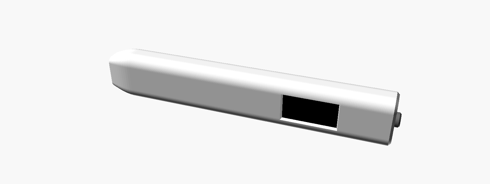
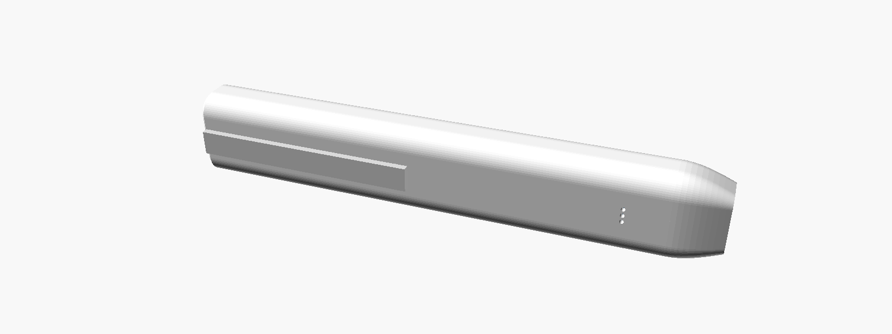

# Voice pen

A pen-shaped voice recorder you clip in a pocket. Click the top, talk, click again. The pen saves the recording, sends it to your Mac over Wi-Fi, and the Mac transcribes it locally with Whisper, free and private. The first lines of the transcript come back to a small e-ink window on the pen and stay there, with no power, until the next note.




*OpenSCAD previews of the CAD model. Not a printed part, and not approved as final styling.*

Status: **designed, not built.** The firmware compiles in CI and the case renders, but no part of this has run on hardware or been printed. See [Validation plan](#validation-plan).

## Brief

Following the Agent Cody Banks project brief template.

- **Goal:** a pocketable, single-button voice recorder with transcription, an e-ink window and a 3D-printed slim pen body with a clip.
- **Audience:** Colson, capturing ideas on the go.
- **Constraints:** ESP32 family; parts you can buy online and hand-wire; printable on a hobby FDM printer; transcription free and local, reusing the Mac receiver from the [M5StickC dictation recorder](https://github.com/coobytron/M5-Stick-Plus-1.1---Voice) ([RECEIVER.md](RECEIVER.md)).
- **Non-goals (v1):** on-pen transcription (an ESP32 can't run Whisper), playback, a phone app, a custom PCB.

### Acceptance criteria

- [x] Firmware compiles for the pen and for a bench display (CI).
- [x] Every case part renders from one parametric file (CI).
- [x] The Mac receiver returns the transcript to the pen, and still works unchanged for the M5StickC.
- [ ] One click from sleep starts recording within about a second, without losing the first word.
- [ ] A recording made with no Wi-Fi uploads by itself later and its transcript keeps the time it was spoken.
- [ ] The last transcript stays readable on the e-ink window while the pen sleeps.
- [ ] Everything fits in the printed body and the clip holds on a shirt pocket.

### How "slim" it can be

Apple Pencil-thin (about 9 mm) isn't possible with an e-ink panel, a battery and an ESP32 board inside. The smallest practical stack with off-the-shelf parts gives a cross-section of **21.4 x 13.6 mm** and a length of **about 130 mm**: closer to a flat highlighter than a ballpoint. The XIAO board's 17.8 mm width sets the width; its stacked height with the mic board sets the thickness. A custom PCB is the way to get thinner (see [Later](#later)).

## How it works

```text
 click            click again           Wi-Fi (when in reach)                     e-ink
┌──────────┐ PCM ┌───────────────┐    ┌──────────────────────────┐  "TEXT ..."  ┌──────────────┐
│ PDM mic  ├────►│ WAV on micro- ├───►│ Mac: mac/receiver.py     ├─────────────►│ last         │
│ 16 kHz   │     │ SD /rec/      │    │ whisper.cpp, ~/Dictation │              │ transcript   │
└──────────┘     └───────────────┘    └──────────────────────────┘              └──────────────┘
```

1. **Asleep.** The ESP32-S3 is in deep sleep. The e-ink keeps showing the last transcript, sync status and battery, using no power.
2. **Click.** The button wakes the chip. The mic starts first, before the card and screen, so words spoken during the ~1 s boot are buffered (64 KB, about 2 s) rather than lost. The screen shows a timer and level bar, refreshed once a second.
3. **Click again.** The WAV is closed on the microSD card as `/rec/<n>_<unix time>.wav`. Clips under half a second are discarded as mis-clicks.
4. **Sync.** The pen joins Wi-Fi, finds the Mac over Bonjour and uploads every waiting recording, oldest first, deleting each once the Mac confirms. For the newest one it asks for the text back and waits up to 90 s.
5. **Sleep.** The home screen is drawn and the pen sleeps. If anything is still waiting (no Wi-Fi, Mac off), it wakes every 30 minutes to retry.

### Why these choices

- **Record first, upload later**, not stream like the M5StickC firmware: a pen is used away from Wi-Fi, and Wi-Fi off while recording saves battery. The microSD card holds hours of audio at 32 KB/s.
- **Same protocol and receiver as the [M5StickC dictation recorder](https://github.com/coobytron/M5-Stick-Plus-1.1---Voice)**, so one Mac app serves both devices. The pen adds two optional header fields that older receivers ignore (see [RECEIVER.md](RECEIVER.md#protocol)).
- **Seeed XIAO ESP32-S3 Sense**: one 21 x 17.8 mm board with a PDM mic, microSD slot, 8 MB PSRAM, LiPo charging and USB-C. Fewer hand-made connections than any combination of separate boards.
- **0.97" e-ink (Good Display GDEM0097T61, 184 x 88, SSD1680)**: the narrowest panel found that fits across a pen (30.0 x 14.15 mm outline), keeps its image without power, and reads in sunlight.
- **One button**, like a click pen. No menus: everything else (sync, retry, sleep) happens by itself.

### Screens

| When | Shows |
| --- | --- |
| Asleep | "Synced" or "3 waiting", battery %, and the first lines of the last transcript |
| Recording | ● REC, elapsed time, level bar |
| After recording | "Sending", then "Transcribing on your Mac..." |
| Problem | "No Wi-Fi", "Mac not found", "Upload failed": the recording is kept and retried. "No card", "Card error", "Card full", "Battery low" |

The fonts are ASCII-only, so the receiver sends the transcript folded to plain ASCII (curly quotes become straight, accents are dropped). The full transcript on the Mac is untouched.

## Parts

Prices vary; check current listings.

| Part | Notes |
| --- | --- |
| Seeed Studio XIAO ESP32-S3 **Sense** | Use the board and its Sense expansion board (mic + microSD). Leave the camera unplugged. Keep the Wi-Fi antenna it ships with. |
| Good Display GDEM0097T61 0.97" e-ink | 184 x 88, SSD1680, 18-pin FPC. |
| Good Display DESPI-C02-CV0097 adapter | The panel needs this board's boost circuit. Its size isn't published: measure it before printing (see below). |
| LiPo pouch cell, about 8 x 15 x 40 mm (size code 801540) | Must have a protection circuit. Any capacity the seller states for this size; battery life is not measured yet. |
| 6 x 6 mm tactile switch | The click button. 5 mm total height. |
| 2 x 220 kΩ resistors | Battery-voltage divider. |
| microSD card, up to 32 GB, FAT32 | |
| Thin silicone wire (30 AWG) | |
| Filament | PETG for the clip (it flexes; PLA clips snap). PLA or PETG for the rest. |

## Wiring

| From | To XIAO pin | GPIO |
| --- | --- | --- |
| E-ink adapter CS | D0 | 1 |
| E-ink adapter D/C | D1 | 2 |
| E-ink adapter RES | D2 | 3 |
| E-ink adapter BUSY | D3 | 4 |
| E-ink adapter SCK | D8 | 7 |
| E-ink adapter SDI | D10 | 9 |
| E-ink adapter 3.3V / GND | 3V3 / GND | |
| Button, one leg | D4 | 5 |
| Button, other leg | GND | |
| Battery + via 220 kΩ, and 220 kΩ to GND (midpoint to pin) | D5 | 6 |
| Battery + / − | BAT+ / BAT− pads on the back of the XIAO | |

The e-ink shares the SPI bus with the Sense board's microSD card (CS on GPIO 21). GPIO 21 is also the XIAO's orange LED, so it flickers while the card is busy; that's expected.

## Print and assemble

The case is one parametric file, [`cad/pen.scad`](../cad/pen.scad). Ready-made STLs for the default sizes are in [`cad/stl/`](../cad/stl), already in print orientation.

1. **Measure first.** Open `pen.scad` and check every value marked `MEASURE` against your parts with calipers: the XIAO stack height, where its USB-C port and mic sit, the e-ink adapter's size, your battery, and your charging cable's plug. Then re-export:
   ```sh
   cd cad
   for p in body sled cap plunger clip; do openscad -D "part=\"$p\"" -o stl/$p.stl pen.scad; done
   ```
   OpenSCAD stops with a message if a part no longer fits.
2. **Print.**

   | Part | Orientation | Notes |
   | --- | --- | --- |
   | `body` | upright, tip down | One seamless tube. 0.2 mm layers; no supports. |
   | `sled` | flat, back down | Carries the battery and display. |
   | `cap` | top down | Holds the switch and plunger; the clip slides into its dovetail. |
   | `plunger` | flange down | |
   | `clip` | outer face down | PETG. |

   `clear`, `slide` and `wall` at the top of the file tune fits for your printer.
3. **Assemble.** Slide the XIAO in from the top, USB-C first, until its port lines up with the tunnel in the tip. Put the battery in the sled's bay (open side toward the window) and the adapter in the pocket above it; tape the panel to the adapter's front so its active area lines up with the window, folding the flex cable into the 1.5 mm gap below. Route wires down the sled's back channel and slide the sled in after the board. Drop the plunger into the cap, fit the switch into the pocket under it, slide the clip into the cap's dovetail from below, and press the cap into the body. The body's top edge locks the clip.

## Flash

You need [PlatformIO](https://platformio.org/install).

1. Copy `firmware/src/secrets.example.h` to `firmware/src/secrets.h` and add your Wi-Fi.
2. Hold the XIAO's **B** (boot) button while plugging it in (the pen deep-sleeps, which turns USB off), then:
   ```sh
   cd firmware
   pio run -t upload
   ```
3. Start the receiver on your Mac as described in [RECEIVER.md](RECEIVER.md).

To try the firmware before the 0.97" panel arrives, wire a common 2.13" SSD1680 module (GDEY0213B74, or a WeAct 2.13" board) the same way and flash `pio run -e bench213 -t upload`.

## Code map

| File | Responsibility |
| --- | --- |
| `firmware/src/main.cpp` | Wake, record to microSD, sync, sleep |
| `firmware/src/screen.{h,cpp}` | Every e-ink screen |
| `firmware/src/config.h` | Pins and tunables |
| `firmware/lib/GxEPD2_097_T61/` | 0.97" panel driver: GxEPD2's SSD1680 2.13" driver with the panel size changed (GxEPD2 has no 0.97" class). GPL-3.0, like GxEPD2. |
| `cad/pen.scad` | The whole case |
| `mac/receiver.py` | Mac receiver: transcribes with whisper.cpp and replies with the text |

## Validation plan

Nothing below has been checked on hardware.

- [x] CI builds both firmware environments (`pen`, `bench213`) and renders every case part.
- [x] Receiver tested on Linux with a stand-in for whisper.cpp: `ts=` names files by the recording time, `reply=text` returns ASCII text, same-second uploads get separate files, and a client that sends neither field gets the old behaviour.
- [ ] **Display driver:** the 0.97" panel shows a correct, unshifted image. The driver is the 2.13" one with the size changed; if the image is offset or garbled, the panel's RAM window differs and needs the vendor's sample code (Good Display, "GDEM0097T61 Arduino Sample Code").
- [ ] Partial refresh after deep sleep doesn't leave heavy ghosting (a full refresh runs every 6th home screen).
- [ ] **Mic:** channel format (`I2S_CHANNEL_FMT_ONLY_LEFT`) and gain (`kMicGain` = 4) give clean audio. Check with `--keep-audio`.
- [ ] Words spoken right after the wake click are in the recording.
- [ ] Battery reading matches a multimeter; set `kBatteryEmptyMv` / `kBatteryFullMv`.
- [ ] Sleep current and battery life, measured.
- [ ] Wi-Fi range from inside the printed body.
- [ ] All `MEASURE` values in `pen.scad` checked against real parts; a test print of the body's tip and the cap fits.
- [ ] The clip holds on a shirt pocket and doesn't crack after 50 clip-ons.

## Later

- A custom PCB with the ESP32-S3, mic and e-ink booster on one board, for a body around 12 mm thick.
- Show the transcript on the Mac in Apple Notes (shared with the dictation roadmap).
- Haptic tick on start and stop, so you know it's recording without looking.
- Compress audio on the pen (ADPCM) to cut upload time by four.
